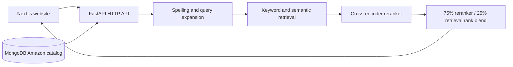

# Architecture and folder responsibilities

## Ownership

- `backend/api/main.py` defines function-based health, search, and dashboard routes and starts Uvicorn.
- `backend/api/search_service.py` loads models and reuses the search index.
- `backend/api/dashboard.py` builds catalog summaries for the dashboard.
- `backend/src/data/catalog.py` loads catalog records and their import version.
- `backend/src/search/product_search.py` implements the serving search pipeline.
- `backend/src/semantic/` owns model training, embedding generation, and evaluation tools.
- `backend/scripts/` provides operator commands; `backend/notebooks/` contains cloud experiments.
- Root `frontend/` owns the user interface. Its illustrative landing-page fixtures are
  separate from the live MongoDB search catalog.
- `backend/models/`, `backend/indexes/`, `backend/reports/`, and `backend/colab/` contain generated local artifacts.

## Storage

`backend/data/dataset/raw/` holds the original search dataset. Its `prepared/`
sibling holds the processed product catalog and training, validation, and test files.

The MongoDB collection `amazon_products` stores the prepared Amazon products.
`catalog_manifests` records the successful import version. The importer upserts
records without deleting other collections. Serving does not fall back to JSON.
The serving cache under `backend/indexes/catalog` contains vectors and product IDs;
serving loads product records from MongoDB. Offline FAISS caches also serialize
product metadata. Publish serving catalog changes through the importer to update
the cache version.

## Configuration

Copy `backend/.env.example` to `backend/.env` and set your values.
Backend commands load `backend/.env` without overriding shell exports. Model paths are relative to
`backend/` unless absolute paths are provided. Model downloads and
training belong in preparation workflows, not HTTP requests.

The frontend reads `NEXT_PUBLIC_API_URL`; see its API client for the default.
