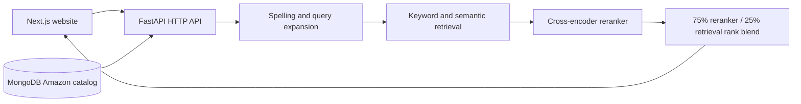

# Architecture and folder responsibilities

## Ownership

- `backend/api/main.py` defines function-based health, search, and dashboard routes and starts Uvicorn.
- `backend/api/search_service.py` loads models and reuses the search index.
- `backend/api/dashboard.py` builds catalog summaries for the dashboard.
- `src/data/catalog.py` loads catalog records and their import version.
- `src/search/product_search.py` implements the serving search pipeline.
- `src/semantic/` owns model training, embedding generation, and evaluation tools.
- `scripts/` provides operator commands; `notebooks/` contains cloud experiments.
- Root `frontend/` owns the user interface. Its illustrative landing-page fixtures are
  separate from the live MongoDB search catalog.
- `models/`, `indexes/`, `reports/`, and `colab/` contain generated local artifacts.

## Storage

`backend/data/dataset/raw/` holds the original search dataset. Its `prepared/`
sibling holds the processed product catalog and training, validation, and test files.

The MongoDB collection `amazon_products` stores the prepared Amazon products.
`catalog_manifests` records the successful import version. The importer upserts
records without deleting other collections. Serving does not fall back to JSON.
Vector caches contain vectors and product IDs; product records are loaded from
MongoDB. Publish catalog changes through the importer to update the cache version.

## Configuration

Copy `backend/.env.example` to `backend/.env` and set your values.
The API loads `backend/.env` without overriding shell exports. Model paths are relative to
the application workspace unless absolute paths are provided. Model downloads and
training belong in preparation workflows, not HTTP requests.

The frontend reads `NEXT_PUBLIC_API_URL`; see its API client for the default.
