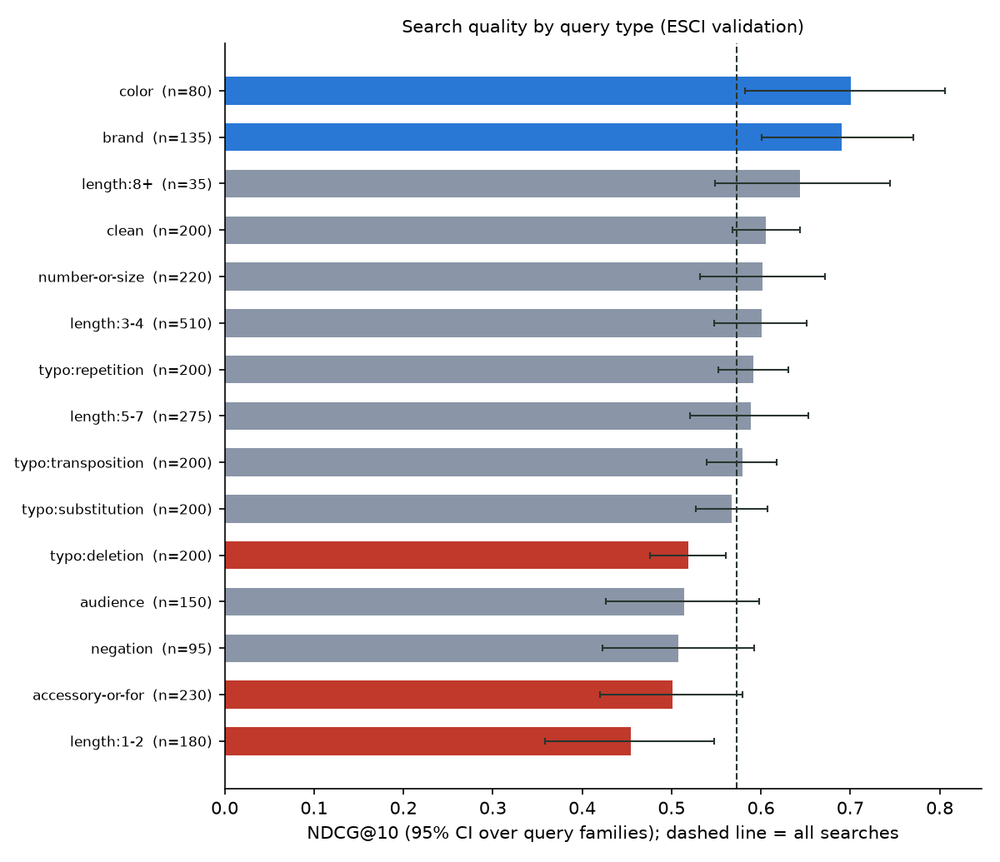
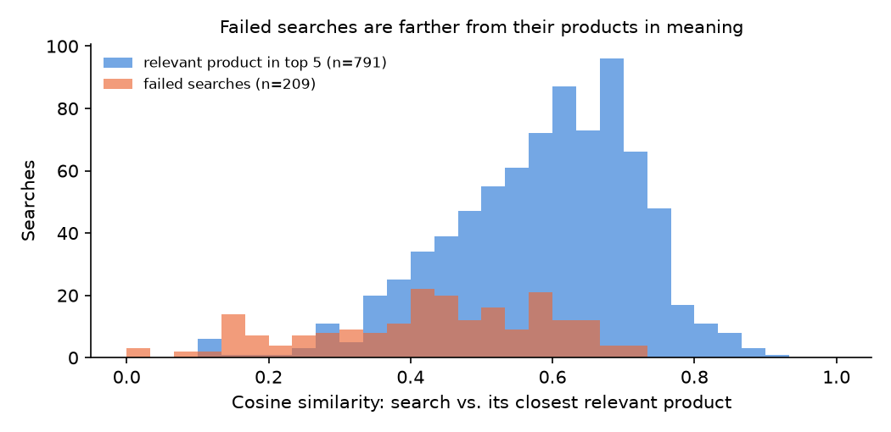
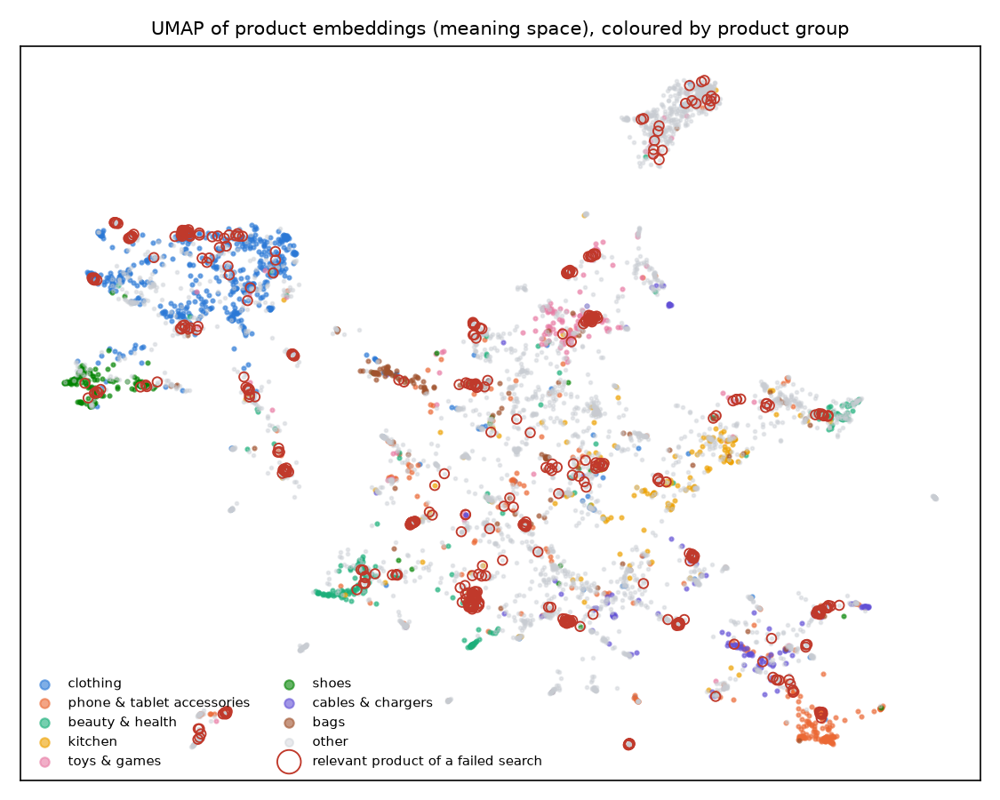

# Error analysis: where and why search fails

This analysis asks which kinds of searches go wrong, and why, so that the next
fixes target real failures rather than guesses.

**Data:** the ESCI **validation** split. That is 200 query families, each as one
correctly typed query plus four typo variants, so 1,000 searches. The test split
is deliberately left out: studying its failures and then fixing them would make
its final numbers optimistic.

**Pipeline:** the served search (spelling, keyword + meaning retrieval,
cross-encoder, 25/75 blend), at the commit recorded in
`backend/quality/error_analysis.json`.

**Definitions**
- **Relevant** means an **Exact** product. The prepared ESCI files list only Exact
  products as relevant, so Hit@5, MRR and Recall everywhere in this project count
  Exact matches only; NDCG uses all grades (Exact 3, Substitute 2, Complement 1).
- A search **fails** when no Exact product is in the top 5.
- **Intervals** are 95% bootstrap intervals over query families. Typo variants of
  one query are not independent, so whole families are resampled.

## Summary

| | Value |
|---|---|
| NDCG@10, all 1,000 searches | **0.573** (95% CI 0.536 – 0.610) |
| Searches that fail (no Exact match in the top 5) | **20.9%** |
| …that also have no Substitute in the top 5 | **10.0%** |
| Searches where an Exact product is among the candidates | **95.3%** |

Retrieval almost always finds a right product; **most failures happen in the
final ordering**. Half of the "failed" searches still show a close alternative
(a Substitute) in the top 5.

## 1. Which searches are hard



Red bars are significantly worse than the other searches, blue bars significantly
better (95% interval of the difference excludes zero).

| Query type | Searches | NDCG@10 (95% CI) | vs. all other searches |
|---|---|---|---|
| **1–2 words** | 180 | 0.454 (0.358 – 0.547) | **−0.144** (−0.251 to −0.039) |
| **Accessory or "for X"** | 230 | 0.501 (0.420 – 0.580) | **−0.093** (−0.183 to −0.003) |
| "without / no / not" (negation) | 95 | 0.508 (0.423 – 0.592) | −0.072 (−0.167 to +0.023) |
| Audience (men / women / kids…) | 150 | 0.514 (0.426 – 0.598) | −0.068 (−0.167 to +0.026) |
| **Typo: a deleted letter** | 200 | 0.519 (0.476 – 0.561) | **−0.067** (−0.124 to −0.010) |
| Typo: wrong letter | 200 | 0.567 | −0.007 (n.s.) |
| Typo: swapped letters | 200 | 0.579 | +0.008 (n.s.) |
| Typo: repeated letter | 200 | 0.592 | +0.024 (n.s.) |
| Correctly typed | 200 | 0.606 (0.568 – 0.644) | +0.041 (n.s.) |
| Numbers or sizes | 220 | 0.601 | +0.037 (n.s.) |
| **Names a brand** | 135 | 0.690 (0.601 – 0.770) | **+0.136** (+0.040 to +0.227) |
| **Names a colour** | 80 | 0.701 (0.582 – 0.806) | **+0.139** (+0.016 to +0.256) |

- **Very short searches are the hardest.** "dog bed" or "cable" match thousands of
  products, and ESCI's judges had specific ones in mind. 36% of them fail.
- **Accessory and "for X" searches** ("case for iphone 12", "dutch oven cleaner")
  are pulled towards the main product they mention.
- **A deleted letter is the most damaging typo.** It often turns the word into a
  different valid word or prefix; swapped or repeated letters are corrected well.
- **Specific searches do well.** A brand or colour narrows the meaning, and the
  cross-encoder uses it.
- Negation and audience words look harmful but are not significant with this
  many families (19 and 30).

## 2. Why searches fail

| Cause (209 failed searches) | Count | Share | What it means |
|---|---|---|---|
| Unjudged product ranked first | 64 | 31% | The top result was never judged by ESCI; it may well be fine |
| **Retrieval miss** | 47 | 22% | No Exact product among the candidates at all |
| Substitute ranked first | 36 | 17% | A close alternative beat the Exact product |
| Other ordering problem | 21 | 10% | An Exact product was found but ranked below judged non-matches |
| Wrong product type | 14 | 7% | The top result is a different kind of product (all from typo searches) |
| "without X" ignored | 14 | 7% | The top result has exactly what the shopper excluded |
| Wrong number or size | 10 | 5% | e.g. a model number or "stage 1" vs "stage 2" |
| Wrong brand | 3 | 1% | The search named a brand; the top result is another |

Where were the Exact products in ordering failures? **98 of 162 (60%) were at
positions 6–10**: near misses that a small ordering change could fix. Only 25
were below position 20.

Examples (correctly typed searches):

| Cause | Search | Ranked first | Exact product (position) |
|---|---|---|---|
| "without X" ignored | *$50 visa gift cards without fees* | $50 Visa Gift Card (plus $4.95 Purchase Fee) | 12 |
| "without X" ignored | *face masks without ear loops* | Face mask … with … ear loops | 6 |
| Number or size | *stage 1 baby food banana* | Earth's Best Organic **Stage 2** Baby Food | 9 |
| Number or size | *kenwood kdc x300* | Kenwood Excelon **KDC-X304** | 11 |
| Substitute first | *bulk kit kat* | KIT KAT Miniatures Assorted | 14 |
| Retrieval miss | *dutch oven cleaner* | Cast iron chain-mail scrubber | not found |
| Unjudged first | *athletica leggings for women* | Reebok Women's Leggings (unjudged) | 17 |

### A caveat about the labels

ESCI judged about 40 products per query. In 130 of the 162 ordering failures, at
least one top-5 product was **never judged**, and only 32 had all five judged
non-matching. Part of the measured failure rate is therefore missing labels, not
bad results. This affects every system equally, so comparisons stay fair, but
absolute numbers understate quality.

## 3. The meaning gap



For each search, the cosine similarity between the search and its closest Exact
product (fine-tuned MiniLM). Successful searches have a median of **0.61**; failed
ones **0.45**. When the encoder places the right product far from the search,
the cross-encoder rarely rescues it. Failures are largely a **representation**
problem, not just an ordering one.



The encoder has learned clear product groups (clothing, shoes, phone accessories,
cables, bags). The Exact products of failed searches (red rings) are spread
across all of them, so failures depend on the **kind of search**, not on one
weak product category.

## What to fix next, in order of expected impact

1. **Fine-tune the cross-encoder on ESCI.** Most failures are ordering failures,
   60% of them near misses, and substitutes often beat exact products. The
   reranker is still the generic MS MARCO model; ESCI's Exact/Substitute labels
   teach exactly this distinction.
2. **Handle negation explicitly.** Drop or demote products containing the words
   after "without / no / not". A small rule fixes a clear, explainable failure.
3. **Treat model numbers and sizes as hard constraints when they appear in the
   search** ("stage 1", "kdc x300", "55 inch"). Exact token matches should
   outrank near numbers.
4. **Make deletion typos safer.** Generate deletion-aware spelling candidates
   (insert one letter) before accepting a correction that is itself a valid word.
5. **Short searches need diversity, not precision.** For 1–2 word searches, show a
   mix of product groups (or "Narrow to" chips) instead of 20 near-identical items.
6. **Fill label gaps before trusting absolute numbers:** judge the top unjudged
   results of failed searches. That would turn 31% of "failures" into known
   successes or real errors.

## Reproduce

```sh
cd backend
.venv/bin/python -m pip install "umap-learn>=0.5.9" matplotlib   # analysis only
.venv/bin/python scripts/error_analysis.py                        # about 1 minute with matching cached rankings
```

It reuses cached rankings, including those saved by the learning-to-rank feature
script, when their catalog, validation data, model files and pipeline version match
the current run. A cache miss runs the pipeline (about 30 minutes on CPU). Pass
`--run` to force a fresh run. The script updates
`backend/quality/error_analysis.json` and the figures above.
